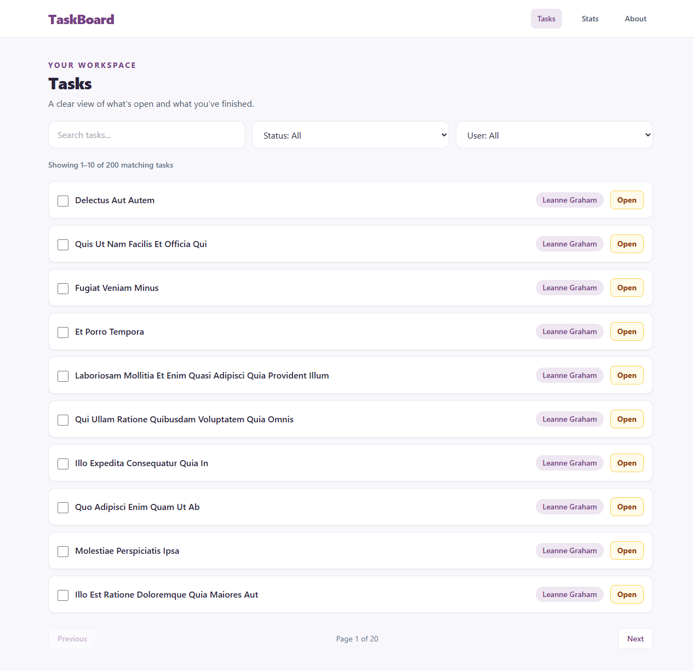
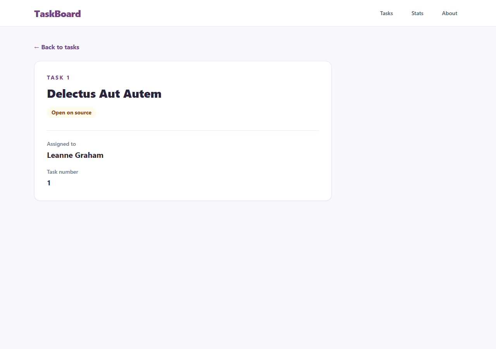
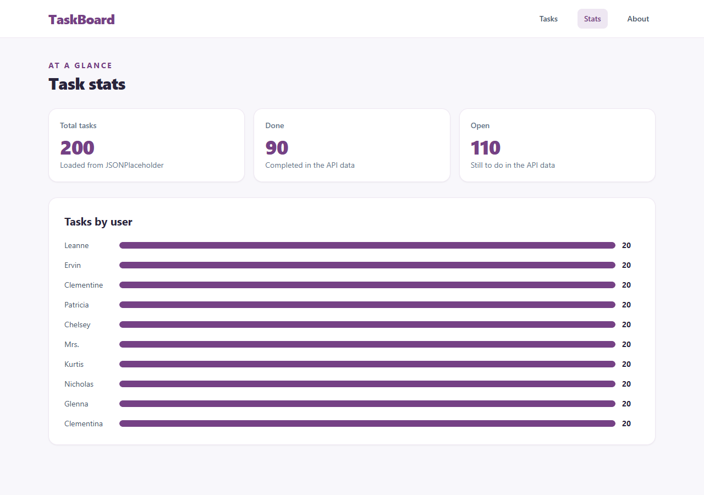

# TaskBoard

A simple task and productivity manager built with React. Browse tasks, filter by status or user, open a task detail page, and review task counts.

## Features and routes

- `/` — search, filter, and browse tasks. The done checkboxes are local to the current page view.
- `/tasks/:id` — see one task and its assigned user. The task ID comes from the URL.
- `/stats` — see total, completed, and open task counts, plus a chart of tasks by user.
- `/about` — read about the project and the data source.

## Public API and data fetching

This project uses [JSONPlaceholder](https://jsonplaceholder.typicode.com/), fetching `/todos` for task data and `/users` for names. The detail route fetches `/todos/:id` and `/users/:id`.

TanStack Query manages the server data. Queries use keys such as `['todos']`, `['todos', id]`, and `['users', id]`. Screens show loading placeholders and error messages while requests are pending or fail. The task list also shows an empty state when no results match the selected filters.

## Screenshots

Add screenshots of the Tasks, Task Details, and Stats routes here after running the app. Save them in `screenshots/` and embed them with Markdown, for example:

```md



```

## Setup

```bash
git clone <your-repository-url>
cd <your-repository-folder>
npm install
npm run dev
```

To check the production build, run `npm run build`. To run ESLint, run `npm run lint`.

## Tech stack

React, React Router, TanStack Query, Tailwind CSS, Vite, and JSONPlaceholder.
